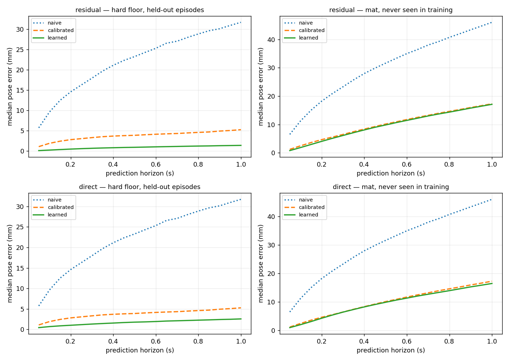

# M2 — Action-conditioned state predictor

**Date:** 2026-10-11 · **Status:** complete, with a caveat · **Milestone:** M2 (simulation only)

## Question

Can a learned model predict pose 1.0 s ahead better than a *calibrated* analytic model — and does
predicting the residual on top of that model beat predicting the dynamics outright?

Expected before running: residual should beat direct in-distribution, and both should beat
calibrated. No strong prior on whether either transfers to an unseen surface.

## Setup

- 60 min of data: 30 episodes `hard`, 30 episodes `mat`, temporally correlated random actions.
- Split **by episode**: 24 hard train / 6 hard held out. All 30 `mat` episodes held out entirely —
  the model never sees that surface.
- Windows: 1.0 s (20 ticks), stride 2. 14,160 train / 3,540 hard test / 17,700 mat.
- Model: GRU(96) over the action sequence, initial hidden from an MLP on the current state
  (`body_vel_avg`, `wheel_meas`, `imu_gyro`, `batt_v`). 39,843 parameters. ~45 s on CPU.
- Output head zero-initialised, so the residual variant *starts* exactly at the calibrated
  baseline and can only improve.
- Reproduce: `python software/models/state_model.py --epochs 25 --stride 2 --variant both`

## Result

Median pose error at a 1.0 s horizon. All three predictors get the same information, including
the measured velocity at the start of the window.

| Predictor | hard (held out) | mat (never seen) |
|---|---:|---:|
| Naive analytic | 31.73 mm (22.1% of path) | 46.06 mm (38.7%) |
| Calibrated analytic | 5.27 mm (3.7%) | 17.30 mm (14.7%) |
| **Learned, residual** | **1.40 mm (1.0%)** | 17.11 mm (14.9%) |
| Learned, direct | 2.57 mm (1.8%) | 16.51 mm (14.4%) |

**Three findings:**

1. **S3 passes in-distribution, comfortably.** The residual model beats the calibrated baseline by
   73.4% on held-out hard-floor episodes, against a 30% target.
2. **Residual beats direct, as predicted** — 1.40 mm vs 2.57 mm, a 45% gap on identical
   architecture, parameter count and training budget. Learning a correction to a nearly-right
   model is a genuinely easier problem than learning the dynamics. This is the M2 design claim and
   it holds.
3. **Neither transfers to an unseen surface.** On `mat` the learned model is 1.1% better than
   calibrated (residual) or 4.6% (direct) — i.e. indistinguishable. The left and right panels of
   the figure tell the whole story: on hard the green curve sits far below orange; on mat they lie
   on top of each other.

## What the transfer failure means

The model learned *hard-floor dynamics*, not *dynamics*. Everything it knows about slip is tied to
one surface's friction, and nothing in its inputs lets it identify which surface it is on — the
observation gives it velocity, wheel speeds, gyro and battery, none of which disambiguate carpet
from tile until the robot has already slipped.

That is the correct and expected failure, and it is the whole reason M6 exists. Two routes out,
both worth testing on real hardware:

- **System identification from a short history.** Give the model the last ~1 s of
  (action, achieved velocity) pairs rather than a single instantaneous state. Slip is identifiable
  from the mismatch between what was commanded and what happened — but only if the model can see
  more than one tick of it.
- **Train on both surfaces** and check whether it interpolates to a third.

Note the residual variant transfers slightly *worse* than direct (17.11 vs 16.51 mm). Plausible
reason: it inherits two hard-specific biases — the calibration it is anchored to, and its own
learned correction — where the direct model carries only one. The gap is small and probably within
noise; worth re-checking with multiple seeds before claiming it.

## Failure analysis — the bug that nearly produced a fake result

The first run reported the calibrated baseline at **13.22 mm** and the learned model at 3.79 mm —
a 71% win. Both numbers were wrong, because `first_order_lag` initialised its filter at zero
velocity. That asserts the robot is **at rest at the start of every window**, which is false for
almost all of them, while the learned model was handed the measured current velocity as an input.

Fixing one line — passing `v0` — improved the calibrated baseline from 13.22 mm to **5.27 mm**, a
2.5× gain for free, and it stayed the strongest non-learned predictor.

The headline conclusion survived, but the margin was inflated and the *shape* of the finding
changed: against the fair baseline, the interesting result is no longer "learned models win big"
but "learned models win big **in-distribution and not at all out of it**."

The general lesson, and the reason this section exists: **the quality of the baseline determines
what the experiment can conclude.** A learned model beating a handicapped baseline measures the
handicap. Before trusting any M4/M5 result, check that every predictor receives exactly the same
information.

## Caveats before carrying any of this to hardware

- **1.40 mm will not survive contact with a real floor.** The simulator's slip is a smooth
  deterministic function of state and action, so a GRU can approximate it almost exactly; the
  irreducible noise floor here is roughly 0.2 mm. Real floors have dust, seams, compliance and
  wheel-to-wheel load transfer. Expect the real M2 number to be far worse, and treat this as an
  upper bound on what is learnable, not a forecast.
- **The velocity input is cleaner than reality.** `body_vel_avg` comes from exact pose differences.
  On the robot it will come from the overhead fiducial (noisy, occasionally occluded) or from
  encoder odometry (biased by the very slip being modelled).
- **Absolute millimetres are confounded with path length** — the robot travels less far per second
  on mat. The "% of path" column is the comparable one across surfaces.
- **Single seed.** The residual-vs-direct gap is large enough to believe; the residual-vs-direct
  *transfer* difference is not.

## Next

M3 (action-conditioned video prediction) needs a GPU — this machine has CPU-only torch, so that
one goes to Colab.

Cheaper and more informative first: test the short-history hypothesis above. If feeding the model
one second of (action, achieved velocity) lets it identify the surface and close the `mat` gap,
that is a result worth having *before* any hardware exists, and it changes what the real robot
needs to log.
