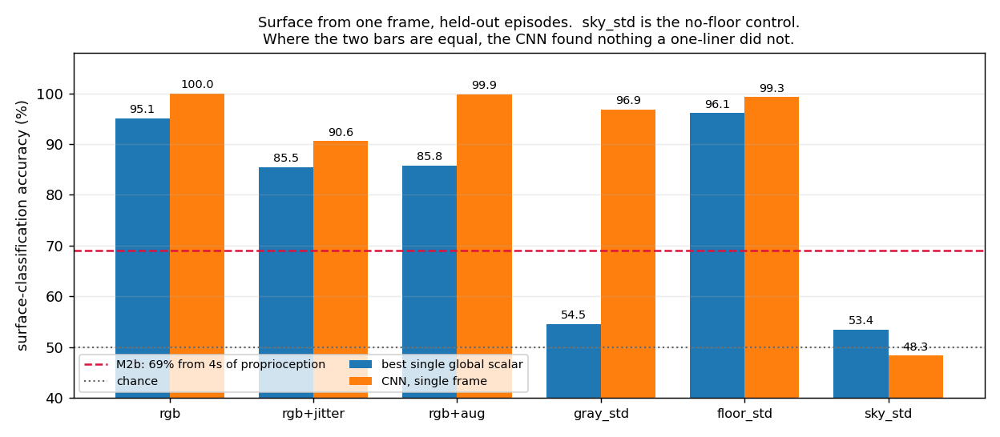
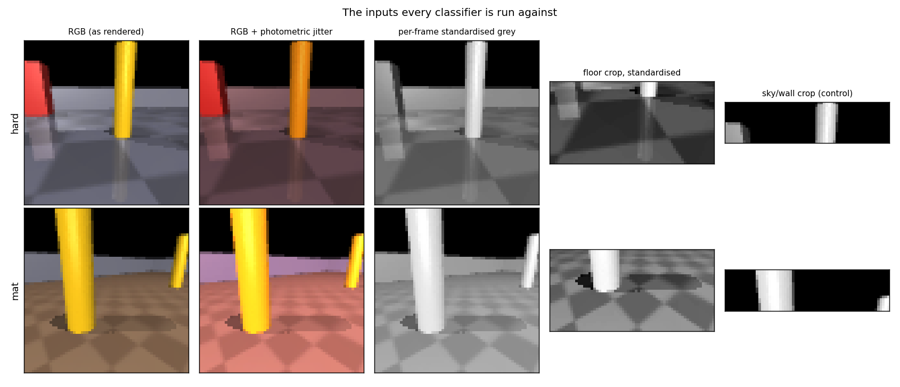
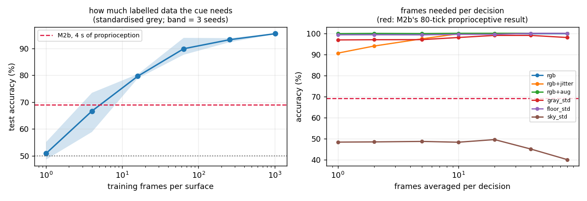
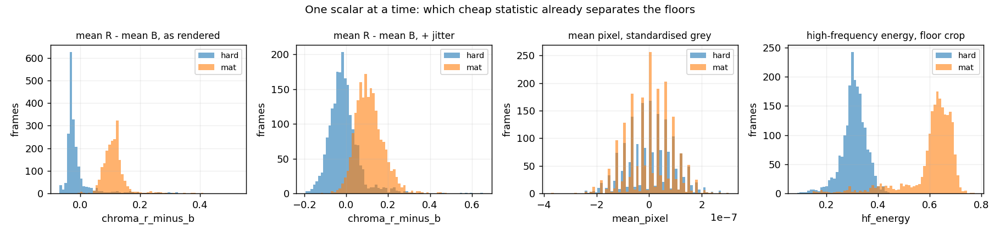
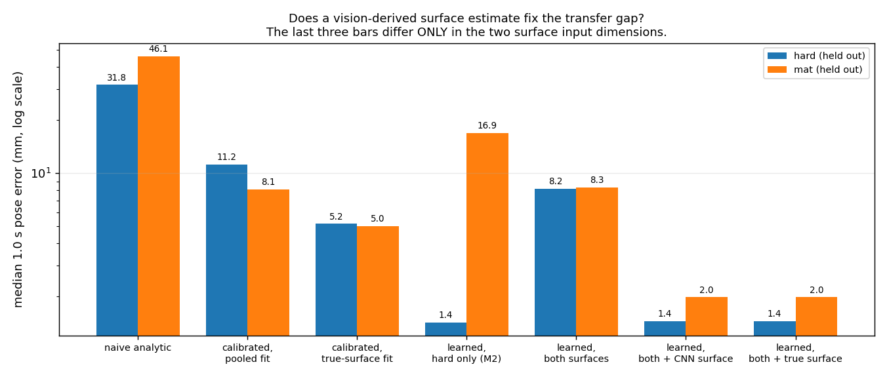
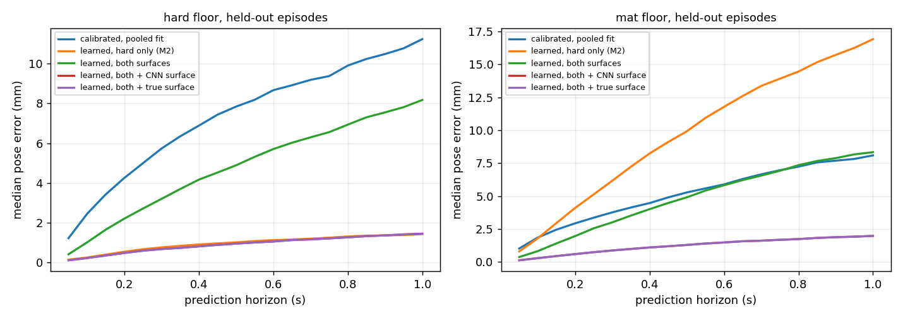
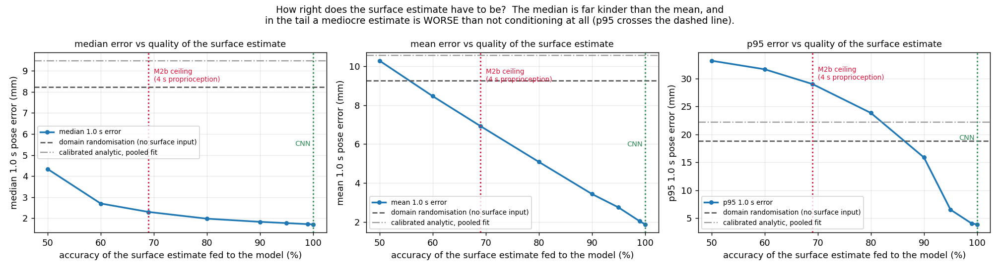

# M3a — Is the surface identifiable from pixels, and does that fix the transfer failure?

**Date:** 2026-10-13 · **Status:** complete — **both hypotheses confirmed, with a large caveat about
how easy the simulated version of the problem is** · **Milestone:** M2b follow-up / M3 precursor

## Question

M2b rejected proprioceptive surface identification: four seconds of `(action, achieved velocity)`
history gives only **69%** surface-classification accuracy, because the between-surface difference
in contact efficiency (0.08) is swamped by actuator-lag transients (sd 0.31) that look identical on
both floors. Its closing argument was that *"carpet and tile are trivially distinguishable by
appearance"*, making vision the leading candidate.

That was an assertion, not a measurement. Two questions here:

1. **Can a small CNN classify the surface from a single 64×64 frame?**
2. **If so, does conditioning the M2 dynamics model on a vision-derived surface estimate actually
   close the transfer gap?**

Expected before running:

- **Part 1: yes, and embarrassingly so** — the two simulated floors have different flat colours, so
  a CNN should hit ~100% and the result would mostly be measuring the simulator. I expected the
  interesting number to be the *robustness* one, and expected a one-line mean-pixel classifier to
  match the CNN.
- **Part 2: a modest improvement.** I expected conditioning to help on `mat` and expected *training
  on both surfaces alone* (M2b's cheaper route 2) to get most of the way there, leaving vision with
  a small marginal win.

**Part 2's expectation was wrong, and that is the most useful thing in this write-up.**

## Setup

### Dataset (new — `software/data/vision/`, gitignored, 284 MB)

`sim/collect.py` has never been run with `--video` since the floor materials were split, so there
is no paired frame dataset. Collected one with `models/surface_cnn.py --collect`:

- 30 episodes × 400 ticks (20 s) per surface, front camera at 64×64, temporally correlated random
  actions. 12,000 frames per surface, ~16 s wall clock for both.
- **Start pose and action plan for episode *k* are drawn from an RNG seeded identically on both
  surfaces.** If `hard` episodes started in different parts of the arena from `mat` episodes, a
  classifier could key on which landmark is in view and part 1 would be measuring the collection
  script. Trajectories still diverge — the dynamics differ — but initial conditions do not.
- **The frame is rendered AFTER `env.step()`**, so `frame[t]` is the view from `pose_gt[t]`. See
  *Notes on files I do not own* below; `sim/collect.py` renders before the step.
- Verified against the schema unit test in `software/README.md`: integrating `body_vel_avg[t+1…]`
  from `pose_gt[t]` reproduces `pose_gt[t+20]` to **0.0000 mm** (off by one: 15.5 mm).

### Splits

**By episode, never by frame.** Episodes 0–19 train, 20–24 val, 25–29 test, on both surfaces.
Adjacent frames at 20 Hz are near-duplicates; a random frame split puts copies of the same image on
both sides and reports ~99% for a classifier that has learnt nothing.

### Part 1 — classifiers

`SurfaceCNN`: three stride-2 convs (8/16/32 channels), global average pool, linear. **6,098
parameters**, 4–19 s to train on CPU. Deliberately tiny: if the floor is identifiable at all it is
identifiable from a texture statistic, and a bigger network would only make it harder to argue
about what was learnt.

Against it, three **one-line global-scalar classifiers**, each computed from exactly the tensor the
CNN is handed, with a single threshold fitted on train: mean pixel value, mean R − mean B, and
high-frequency energy (mean |Laplacian| ÷ image sd). The scalar baselines are the whole point — the
question is not "can a CNN do it" but "did the CNN find anything a one-liner did not".

Six input views, of decreasing generosity:

| view | what it removes | why |
|---|---|---|
| `rgb` | nothing | what a model would actually see |
| `rgb+jitter` | — (nuisance added at **test only**) | brightness ×[0.6,1.4] and per-channel ×[0.8,1.2]: the cheapest stand-in for room light and auto white balance |
| `rgb+aug` | — (same nuisance at **train and test**) | does augmentation recover it |
| `gray_std` | chroma, and global brightness/contrast (per-frame standardised greyscale) | leaves only spatial structure |
| `floor_std` | as above, bottom half only | the camera's 15° downward tilt fills the bottom half with floor |
| `sky_std` | as above, **top quarter only — contains no floor at all** | the control, see below |

`sky_std` exists because of a confound I found in the data: `mat` slips more, so the robot stays
nearer the arena centre (mean |pos| 0.27 m vs 0.31 m on `hard`). The scene behind the floor is
therefore *weakly surface-correlated through the trajectory*. If a classifier works on sky and wall
alone, part of every other number is that confound rather than the floor.

### Part 2 — vision-conditioned dynamics

Identical to M2 (residual GRU(96) on top of the calibrated analytic prior, `history=1`, 1.0 s /
20-tick horizon), with one change: a 2-dimensional surface code appended to the state features
(14 → 16). 62,211 parameters. 15,160 train windows (stride 1, 7,580 per surface), 1,900 test
windows (stride 2) from the 10 held-out episodes.

**All four learned predictors have identical architecture and parameter count.** The ones that are
not supposed to know the surface get a constant `0.5` in those two slots rather than having the
slots removed — otherwise "knows the surface" would be confounded with "is a slightly bigger
model". The residual prior underneath rows 5–7 is the same pooled calibration, so those three
differ *only* in two input numbers.

The window builder is duplicated in `vision_conditioned.py` (to carry the frame index along) and
asserted element-for-element equal to `state_model.build_windows` on every run.

### Reproduce

```bash
cd Project/arkham-batmobile/software
python models/surface_cnn.py --collect        # ~16 s, writes data/vision/ (284 MB)
python models/surface_cnn.py                  # part 1, ~2 min
python models/vision_conditioned.py           # part 2, ~2 min
python models/vision_conditioned.py --plot-only   # figures from metrics_part2.json
```

---

## Result — part 1: yes, trivially, and that is the problem

Single held-out frame, 4,000 test frames from 10 episodes neither classifier has seen.

| Input | best single global scalar | | CNN, 1 frame |
|---|---:|:--|---:|
| `rgb` | **95.1%** | *(mean R − mean B)* | **100.0%** |
| `rgb+jitter` *(train clean)* | 85.5% | *(mean R − mean B)* | 90.6% |
| `rgb+aug` *(train with jitter)* | 85.8% | *(mean R − mean B)* | **99.9%** |
| `gray_std` | 54.5% | *(high-freq energy)* | **96.9%** |
| `floor_std` | **96.1%** | *(high-freq energy)* | **99.3%** |
| `sky_std` — **no-floor control** | 53.4% | *(mean pixel)* | **48.3%** |
| *M2b, 4 s of proprioception* | — | | *69.0%* |





**Five findings:**

1. **The headline is overwhelming and nearly meaningless on its own.** 100% from one 64×64 frame
   against 69% from 80 ticks of proprioception. One frame — 50 ms — beats four seconds of feeling
   the floor, by 31 points.

2. **A one-line classifier gets 95.1%.** The two floors have mean RGB `[71.7, 69.3, 73.7]` and
   `[88.8, 72.9, 60.1]`. Thresholding `mean(R) − mean(B)` — literally one scalar per frame — scores
   95.1%. The CNN's extra 4.9 points is all it contributed. **In the clean RGB condition this
   experiment measures "is it browner?", not computer vision.**

3. **Choosing the wrong one-liner nearly produced a false claim.** My first baseline was mean
   *greyscale*, which scores only 60.7% — the two floors are almost identical in luminance (70.5 vs
   76.2) and differ in chroma. Reporting that would have supported "the CNN found structure a
   simple statistic cannot", which is false. See *Failure analysis*.

4. **There is a second, independent cue, and it survives removing colour.** With chroma and global
   brightness stripped per frame, the CNN still scores **96.9%**, and **99.3%** on the floor crop.
   That cue is checker pitch — `mecanum_base.xml` gives the two floors `texrepeat` 10 and 26 — and
   a single high-frequency-energy scalar on the floor crop recovers **96.1%** of it. So the harder
   condition is *also* one global statistic, just a less obvious one.

5. **The no-floor control is at chance (48.3%), which is the result that makes the rest usable.**
   The trajectory confound is real but does not carry the signal: the CNN is reading the floor, not
   where the robot likes to be. Without this control none of the above could be claimed.

### Robustness: the clean result is brittle exactly where you would expect

Train clean, test under brightness and colour jitter: 100.0% → **90.6%**. The CNN *is* largely
keying on absolute colour. Training with the same jitter restores 99.9%, which is the fix, but it
is a fix available only because the nuisance was known in advance.

### How few frames?



- **Per decision: one.** In every condition the k=1 accuracy is already at the ceiling
  (`gray_std` 96.9% at 1 frame, 99.0% at 20). Temporal voting buys 2–3 points in the jittered
  condition and nothing elsewhere. Contrast M2b, where accuracy climbed from 59% to 69% over
  80 ticks and was still climbing.
- **Labelled training frames: ~16 per surface.** Subsampling the training set to a fixed
  gradient-step budget (3 seeds), on the hardest honest view: 4 frames/surface → 66.7% (about M2b's
  ceiling), **16 → 79.7%**, 64 → 89.9%, 1,024 → 95.5%. **0.8 s of labelled video per surface already
  beats 4 s of proprioception measured over 30 minutes of driving.**



---

## Result — part 2: conditioning fixes the transfer gap, and domain randomisation does not

Median 1.0 s pose error on held-out episodes of both surfaces. Every predictor receives the same
information, including the measured velocity at window start.

| Predictor | hard (held out) | mat (held out) |
|---|---:|---:|
| Naive analytic | 31.80 mm (23.0% of path) | 46.06 mm (37.8%) |
| Calibrated analytic, **pooled fit** | 11.23 mm (8.4%) | 8.09 mm (7.0%) |
| Calibrated analytic, **true-surface fit** *(analytic oracle)* | 5.17 mm (3.6%) | 5.02 mm (3.9%) |
| Learned, **hard only** *(the M2 predictor)* | **1.37 mm (1.0%)** | 16.78 mm (13.7%) |
| Learned, **both surfaces, no surface input** *(domain randomisation)* | 8.17 mm (6.7%) | 8.33 mm (7.0%) |
| Learned, both + **CNN-predicted** surface | **1.45 mm (1.0%)** | **1.98 mm (1.5%)** |
| Learned, both + **true** surface *(oracle)* | **1.45 mm (1.0%)** | **1.98 mm (1.5%)** |





**The dataset independently reproduces M2.** Naive analytic 31.80/46.06 mm against M2's
31.73/46.06; the hard-only learned model 1.37/16.78 against M2's 1.40/17.11; the per-surface
calibrated fit 5.17 mm on hard against M2's 5.27. Different episodes, different collector, same
numbers. The M2 transfer failure is not an artefact of that dataset.

**Four findings:**

1. **Vision conditioning closes the gap, essentially completely.** On `mat`, 16.78 mm → 1.98 mm —
   **8.5× better**, and within 37% of the in-distribution number on the surface it was tuned for.
   Against the pooled calibrated analytic it is 87% better on hard and 76% better on mat, against
   an S3 target of 30%.

2. **The CNN's estimate *is* the oracle.** 100.00% accurate on all 1,900 window-start frames, so
   rows 6 and 7 are identical to two decimal places. There is no vision-estimate penalty to report,
   because in this simulator there is nothing to penalise.

3. **Domain randomisation alone — M2b's cheaper route 2 — fails, and this is the result I did not
   expect.** Training on both surfaces without telling the model which one it is on gives
   8.17/8.33 mm: it **loses 6× on hard** (1.37 → 8.17) to buy **2× on mat** (16.78 → 8.33), and
   beats the pooled calibrated analytic by only 13%. It is not even clearly better than the
   *analytic* model given the true surface (5.08 mm pooled).

   The training loss says why, and says it is not an optimisation failure: the both-surfaces model
   converges to a velocity MSE of **8.3 × 10⁻⁴**, the surface-conditioned model on the same windows
   to **5.3 × 10⁻⁵** — **16× lower**. With one tick of proprioception the surface is simply not in
   the input, so the model can only fit the average of two different plants. That is the M2b
   identifiability result showing up as a training floor rather than as a classification accuracy.

4. **So vision is not a convenience here. It is the only one of M2b's three routes that works.**

### How accurate does the surface estimate have to be? (and was M2b right to reject 69%?)

Part 1 cannot answer this. Feeding the oracle model a label corrupted at a controlled rate can
(3 seeds per point):

| Surface estimate | median | mean | p95 |
|---|---:|---:|---:|
| 50% (chance) | 4.34 mm | 10.28 mm | 33.20 mm |
| 60% | 2.70 mm | 8.46 mm | 31.67 mm |
| **69%** *(M2b's proprioceptive ceiling)* | **2.30 mm** | **6.92 mm** | **29.03 mm** |
| 80% | 1.98 mm | 5.08 mm | 23.86 mm |
| 90% | 1.83 mm | 3.43 mm | 15.89 mm |
| 95% | 1.77 mm | 2.74 mm | 6.55 mm |
| 100% *(= the CNN)* | 1.71 mm | 1.87 mm | 3.92 mm |
| *domain randomisation, no input* | *8.24 mm* | *9.25 mm* | *18.86 mm* |
| *calibrated analytic, pooled* | *9.48 mm* | *10.56 mm* | *22.23 mm* |



**The answer depends entirely on which statistic you quote, and the honest version is the
unflattering one.**

- **In the median, 69% looks nearly sufficient** — it recovers 91% of the gap between domain
  randomisation and the oracle. Quoting only the median would have produced the headline *"M2b was
  too harsh; 69% would have been enough"*.
- **In the mean it recovers 32%**, because a wrong label does not degrade the prediction, it
  *inverts* it: the model confidently applies the other floor's dynamics.
- **In the p95 — the number a planner lives on — a 69% estimate is 29.0 mm, worse than not
  conditioning at all (18.9 mm) and worse than the plain calibrated analytic (22.2 mm).** The
  break-even is around **86%**. Below that, conditioning on a mediocre surface estimate is actively
  harmful.

So M2b's conclusion stands, but for a sharper reason than it gave. It is not that a 69% estimate
carries no information — it carries quite a lot. It is that a surface-conditioned model fails
*asymmetrically*: the cost of a wrong label is much larger than the benefit of a right one, so the
estimator has to be in the 95–100% band before conditioning is safe. Proprioception cannot reach
that band. A single camera frame is already there.

---

## Failure analysis

**1. The baseline I chose first would have inflated the result — same mistake as M2, different
file.** My first one-line classifier was mean *greyscale* intensity, which scores 60.7%. Against
that, the CNN's 100% looks like it found real structure. It did not: the two floors differ in
chroma, not luminance (mean grey 70.5 vs 76.2; mean R−B −2.0 vs +28.6), and the right one-liner
scores 95.1%. M2's own failure-analysis section says *"the quality of the baseline determines what
the experiment can conclude"*. I reproduced the error one milestone later, in the opposite
direction — not a crippled baseline this time, just an irrelevant one. The generalisation that
actually bites: **a weak baseline and an off-target baseline are the same bug**, and the way to
catch both is to ask what the *simplest thing that could possibly work* is for this specific data,
rather than reaching for a standard one.

**2. A median-only sweep would have reversed the conclusion about M2b.** The median is generous to
a bimodal error distribution, and corrupting a surface label produces exactly that: half the
windows perfect, half badly wrong. Median says 69% recovers 91% of the gap; p95 says it is worse
than useless. I nearly shipped the median-only version. Any experiment where a predictor can be
*confidently wrong* on a subset needs a tail statistic, not a central one.

**3. The trajectory confound was real and I did not anticipate it.** Because `mat` slips more, the
robot covers less ground and stays nearer the arena centre (mean |pos| 0.27 vs 0.31 m). Scene
content is therefore weakly surface-correlated independently of the floor. Matching the start poses
and action plans across surfaces at collection time reduces it but cannot remove it — the
divergence is caused by the very dynamics difference under test. The `sky_std` control (top quarter
of the frame, no floor pixels, 48.3% = chance) is what makes the part 1 numbers safe to quote, and
it was added only after noticing the |pos| difference in the raw data.

**4. What did not go wrong, and was checked anyway.** Episode-level splits throughout; the
duplicated window builder asserted equal to `state_model.build_windows` on every run; the dataset
checked against the `body_vel_avg` alignment unit test (0.0000 mm correct vs 15.5 mm off by one);
all four learned predictors given identical architecture and parameter count, with the uninformed
ones fed a constant rather than having inputs removed.

---

## Caveats — read these before believing any of it on hardware

**The simulated version of part 1 is a cartoon, and I want to be blunt about how much of one.**

- The two floors differ in **two** independent global statistics — flat colour (R−B: −2 vs +29) and
  checker pitch (`texrepeat` 10 vs 26) — each of which is separately recoverable by a *single
  scalar* at 95–96%. Real carpet and real tile differ in fine texture at a scale that a 64×64 frame
  compresses heavily under perspective, in specularity, in how they shadow, and often barely at all
  in mean colour. **100% here is a property of `mecanum_base.xml`, not evidence about reality.**
- **There is no lighting variation in the simulator at all** — fixed lights, no time of day, no
  shadows moving. The photometric jitter is a crude post-hoc stand-in that scales channels; real
  light changes shading and specular highlights, which a per-channel gain does not simulate. The
  90.6% jittered number is therefore an optimistic reading of how brittle the colour cue is.
- **Two surfaces only.** This is binary classification with the classes fixed at collection time.
  A third surface would test whether the one-hot interpolates or whether a continuous surface
  embedding is needed — M2b already flagged this and it still has not been done.
- **The surface is constant within an episode.** Nothing here tests crossing from tile onto a rug
  mid-run, which is the case M2b explicitly named as the reason slow online estimation is useless.
  A hard one-hot would flip discontinuously at the boundary and the residual model has no mechanism
  for a transition.
- **A one-hot cannot represent a worn patch of carpet.** Real floor properties are continuous;
  conditioning on a class label works here because the simulator has exactly two classes.
- **Part 2 is single-seed** for all three dynamics models. The 5× gaps (8.24 vs 1.71 mm) are far
  too large for seed noise, but the 1.45 vs 1.98 mm hard/mat difference inside the conditioned model
  is not established.
- **The dynamics caveats from M2 all still apply**: 1.4 mm is near this simulator's noise floor,
  `body_vel_avg` comes from exact pose differences rather than a noisy fiducial, and absolute
  millimetres are confounded with path length (the "% of path" column is the comparable one).
- **The CNN never sees a floor it has not seen** — only episodes it has not seen. Cross-*material*
  generalisation (train on tile+carpet, identify vinyl) is untested and is the thing that will
  actually matter on hardware.

## Notes on files I do not own

1. **`sim/collect.py` renders the frame *before* `env.step()`**, so `row[t].frame_idx` points at the
   view from `pose_gt[t-1]`, not `pose_gt[t]`. Harmless for video, a silent off-by-one for anything
   that conditions a prediction starting at `pose_gt[t]` on an image. I worked around it by writing
   my own collector that renders after the step. Suggest either flipping the order in `collect.py`
   or stating the convention explicitly in the `frame_idx` row of the schema table in
   `software/README.md`, which currently says only "index into the episode mp4".

2. **`sim/mecanum_base.xml` makes the two floors differ in colour *and* texture scale.** That is two
   free cues where reality often offers one marginal one, and it is why part 1 saturates. A
   genuinely informative sim benchmark would offer a third surface that is *photometrically
   identical* to one of the existing two and differs only in fine texture — that would make
   "identifiable from pixels" a real question rather than a foregone one.

## Next

The useful next step is **not** a bigger vision model. A 6,098-parameter CNN on a single frame
already saturates this task, and the bottleneck established above is the *reliability* of the
surface estimate (break-even ~86%), not the capacity of the estimator.

In order:

1. **Put the conditioned model into the M4 MPPI loop and measure closed-loop success rate.** M4
   found replan rate dominates; 1.98 mm vs 8.33 mm open-loop may or may not survive a 20 Hz
   replanning controller. That is the only number that says whether any of this matters.
2. **Add a third surface** and test whether the one-hot interpolates or a continuous embedding is
   needed. This also upgrades part 1 from binary classification to something that can fail.
3. **Mid-episode surface transitions.** The one case M2b named as decisive, and the one case neither
   M2b nor this experiment tests. A soft/continuous surface estimate is probably required.
4. **Make the simulated surfaces harder** (see note 2 above) before anyone treats "vision solves
   surface identification" as established rather than as "vision solves it in a simulator that was
   built to make it solvable".
