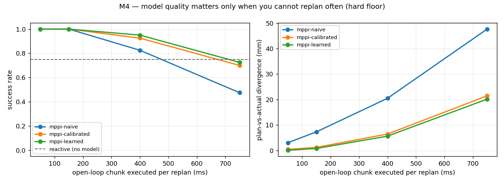
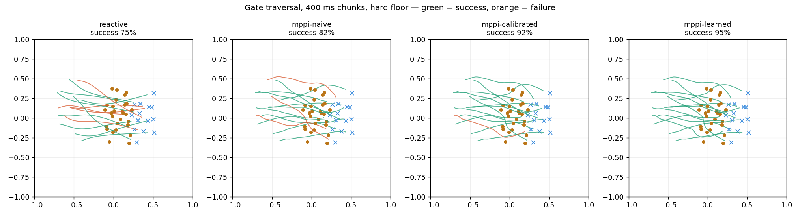

# M4 — Planning inside a learned world model

**Date:** 2026-10-11 · **Status:** complete · **Milestone:** M4 (simulation only)

## Question

Does planning inside the learned world model beat planning inside an analytic one, and does
either beat not planning at all?

That question turned out to be badly posed. It has no answer without specifying **how often you
replan** — so the experiment became a sweep over the open-loop chunk executed between replans.

## Setup

Task: drive through a gate with 18–53 mm of clear air each side of the chassis, stop at a pose
beyond it, within a 4 s limit. Chosen because being wrong about slip has to *cost* something — the
approach usually needs diagonal strafe, the mode that loses most to slip (81% delivered vs 92%
forward). The time limit matters: given 8 s the planner simply creeps through at near-zero speed
and model error never surfaces.

Four conditions, same MPPI (384 samples, 15-step horizon), same cost function, same task
instances and seeds. Only the predictor changes:

| Condition | Predictor |
|---|---|
| `reactive` | none — P controller straight at the goal |
| `mppi-naive` | uncalibrated analytic FK |
| `mppi-calibrated` | analytic FK + fitted per-mode gains and lag |
| `mppi-learned` | the M2 residual GRU |

40 trials per cell. Reproduce: `python software/planning/run_m4.py --trials 40`

## Result

Success rate (collision-free gate traversal reaching the goal):

| Replan interval | naive | calibrated | learned | divergence (naive → learned) |
|---|---:|---:|---:|---|
| 50 ms | 100% | 100% | 100% | 3.07 → 0.10 mm |
| 150 ms | 100% | 100% | 100% | 7.32 → 0.81 mm |
| 400 ms | 82.5% | 92.5% | **95.0%** | 20.51 → 5.65 mm |
| 750 ms | 47.5% | 70.0% | **72.5%** | 47.66 → 20.18 mm |

`reactive` (no model at all): **75%**.

**Three findings.**

1. **Replan rate dominates everything.** At 50–150 ms, every predictor scores 100% — including the
   uncalibrated one that is 30× less accurate. Feedback absorbs model error wholesale. Model
   quality only becomes visible once you are forced to commit to 400 ms or more of open loop.

2. **Most of the benefit is calibration, not learning.** At 750 ms, naive → calibrated is
   **+22.5 points**. Calibrated → learned is **+2.5 points**, which is one trial in forty and
   within noise. Four fitted scalars capture nearly all the available gain.

3. **Planning beats not planning, but only when it can replan.** At 750 ms chunks, MPPI with the
   naive model (47.5%) is *worse* than the model-free reactive controller (75%). A bad model
   committed to for three quarters of a second is worse than no model and a tight loop.

## Why the learned model barely helped

M2 measured the learned model as ~4× more accurate than calibrated. Here it bought 2.5 points.
That gap needed an explanation, so:

| Actions drawn from | calibrated | learned | learned's advantage |
|---|---:|---:|---:|
| Smoothed random exploration (**training distribution**) | 5.03 mm | **0.87 mm** | **83%** |
| MPPI (**deployment distribution**) | 4.44 mm | 2.90 mm | 35% |

0.75 s open-loop error, 48 windows each.

**The learned model's error triples under the planner's action distribution.** The analytic model
does not degrade at all — it has no training distribution to leave.

This is the standard model-based RL failure: the planner is an optimiser, so it seeks out exactly
the action sequences where the model is most confident and least tested. MPPI produces smooth,
goal-directed, often near-saturated action sequences; the model was trained on an
Ornstein-Uhlenbeck random walk. Most of M2's accuracy advantage lives in a region the planner
never visits.

The fix is standard and cheap: **DAgger-style iteration.** Collect data with the planner driving,
retrain, repeat. That is the single highest-value next experiment on the software side, and it
needs no hardware.

## Latency implication

The learned model plans in **40 ms** on CPU — 384 samples, 15-step horizon, single-threaded
numpy + torch. That fits inside a 50 ms control tick, where the sweep shows every predictor
scoring 100%.

So the Raspberry Pi choice in `hardware/BOM.md` holds up: world-model MPPI at 20 Hz is plausible
on it without a Jetson. The sweep also prices latency directly — every 50 ms of added inference
delay pushes you along the x-axis of that curve, and the cliff is between 150 ms and 400 ms.
That is most of M5 answered before the robot exists.

## Failure analysis — a bug that nearly became a finding

The run before this one reported the learned model as **2.3× more accurate and marginally worse**
(72.5% vs naive's 75%). A striking, publishable-sounding result. It was a bug in my cost function.

The barrier term activated below 137 mm from a post, while gate half-widths are 105–140 mm — so a
**perfect centre-line pass was already inside the penalty zone, from both posts at once.** The
gradients cancelled. The planner had no steering signal through the gate and was optimising the
goal term alone. With the cost saturated, no dynamics model could matter.

What exposed it was asking whether the null result had a mechanism. If tight gates caused the
failures, the gates everyone failed should have been narrower than the ones everyone passed. They
were not — **34 mm median clearance on shared failures vs 32 mm on universal successes.** The
difficulty explanation was dead, so something else had to be responsible.

Fixed: barrier margin 12 mm (activates below 99 mm, clear of the 105 mm narrowest perfect pass),
weight raised to compensate for the narrower band. Success rates became monotonic in model quality
immediately.

**A clean negative result and a broken experiment produce identical summary tables.** The
difference only appears when you ask *why*.

### Also: two earlier versions measured nothing

- Gate at 83–133 mm clearance with an 8 s limit: every condition, including model-free reactive,
  scored 100%.
- A 20-trial run showed the learned model uniquely failing at 400 ms (85%, 15% collisions). At 40
  trials it was 95%. Pure noise, and it would have made a confident story about model exploitation.

Both are recorded because tightening a task until your preferred method wins is p-hacking unless
you report the settings that did not separate.

## Caveats

- **Simulation only**, and the dynamics are a slip model I wrote. The *ordering* of these results
  should survive contact with hardware; the magnitudes will not.
- **Single seed per condition**, 40 trials. The +2.5 point learned-over-calibrated gap is not
  significant at this sample size. The +22.5 point calibration gap is.
- **Collision uses a circle approximation** of the chassis at half-width, so a robot passing
  broadside is scored leniently.
- Plan times were measured while other work ran on the machine; treat 40 ms as indicative.

## Next

1. **DAgger loop** — retrain on planner-generated data and re-run this sweep. Directly targets the
   distribution shift above and is the cheapest remaining software win.
2. **Re-run on `mat`** to see whether the learned model's advantage survives a surface it never
   trained on, now that the task discriminates.
3. M5 is largely subsumed: the replan sweep already prices latency. What remains is measuring real
   end-to-end delay on hardware rather than simulating it.
