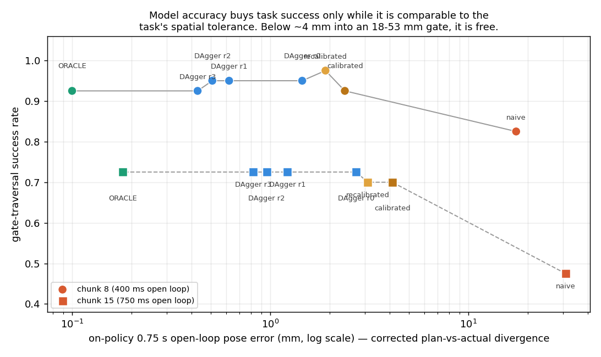
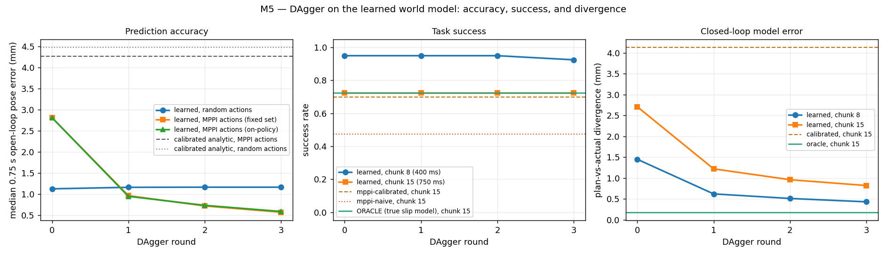
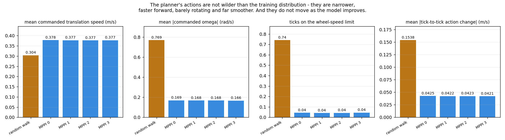

# M5 — DAgger on the learned world model

**Date:** 2026-10-13 · **Status:** complete — **half the hypothesis confirmed, and the half that
failed is the interesting one** · **Milestone:** M5 (simulation only)

## Question

M4 ended with an obvious next step. The learned world model is ~4× more accurate than the
calibrated analytic one on its *training* action distribution and only ~35% better under
*MPPI-generated* actions, because the planner is an optimiser and visits action space differently
from the random walk the model was trained on. Net task gain over calibrated: +2.5 success points,
one trial in forty.

So, the textbook fix — **does collecting data with the planner driving, aggregating, and retraining
close that gap, and does closing it convert into task success at long replan intervals?**

Two claims, measured separately. Written down before running:

- **(a) the accuracy gap closes.** High confidence. This is DAgger on a deterministic simulator
  with a 40k-parameter model; I expected MPPI-distribution error to fall from 2.81 mm toward the
  ~1.1 mm the model already achieves in-distribution.
- **(b) it converts into success.** Weakly — I guessed **+5 points at chunk 15**, reasoning that
  M4's calibrated→learned step bought +2.5 and a DAgger model should be comfortably better than
  that.

(a) is right, and better than predicted. **(b) is wrong, and it is wrong by exactly zero points.**
The reason was measurable in three minutes *before* the loop ran at all, and I nearly didn't
measure it.

## Setup

- Round 0 = the existing 30-episode random-exploration dataset (`data/sim/hard/random`) and the
  existing M2 checkpoint `state_model-residual-h1.pt`. Unchanged.
- Each round N: run MPPI on the gate task with round N−1's model, append the episodes to the
  aggregate, **retrain from scratch**, re-evaluate. 3 rounds, 150 episodes per round
  (~8,200 ticks, 74–96 s of wall clock each; retraining the aggregate takes 43–64 s).
- Collection uses `run_m4`'s own control loop driving a transparent recording proxy
  (`RecordingEnv`), so the collected action distribution *is* the deployment action distribution by
  construction rather than by a reimplementation that drifts.
- Episodes are collected at a mix of replan intervals (chunks 1 / 3 / 8 / 15) so the aggregate
  covers the whole deployment sweep rather than one point on it.
- **Split by episode.** Random data uses M2's 24/6 episode split at stride 2; planner data uses
  stride 1 (planner episodes are ~20× shorter, so this is how window counts become comparable
  without collecting for an hour). Evaluation windows come from gate seeds 11–34, which are never
  trained on.
- **The calibration is frozen** at the round-0 fit (gains 0.93 / 0.83 / 0.77, τ = 80 ms). It is
  both the residual model's prior and the analytic baseline column, so freezing it makes the
  learned model the only moving part. A recalibration control runs at the end.
- Every predictor receives the measured start velocity (`first_order_lag(..., v0=...)`), per M2's
  failure analysis.
- Every dataset is gated on the alignment invariant before training: integrating logged
  `body_vel_avg[t+1…t+20]` from `pose_gt[t]` must reproduce `pose_gt[t+20]`. All eight datasets
  came back at **median 0.0000 mm, max 0.0001 mm**. The deliberate off-by-one control measures
  15.18 mm.
- Reproduce: `python software/models/dagger.py --stage all --rounds 3 --episodes 150 --trials 40`

## Before the loop: two diagnostics, three minutes, and the whole answer

M2b's lesson was that I propose experiments without checking effect size first. So this time, two
checks ran before the loop.

### The ceiling — what is a *perfect* model worth?

`OraclePredictor` plans through the simulator's own dynamics, reading privileged state no learned
model or real robot could have: the real `SlipModel` re-seeded each rollout from `env.slip.state`
(integrated wheel angle, which sets the roller-ripple phase, and pack state of charge), the MuJoCo
velocity actuator as an exact first-order system in the **world** frame
(τ = M_ii/(kv+damping) = 60.3 / 60.3 / 61.2 ms, matching P0's measured 59.3 / 60.2 ms), and the
true `qvel` at plan time. Validated two ways: **0.27 mm** median open-loop error over 0.75 s in an
offline replay against the true simulator, and **0.175 mm** mean plan-vs-actual divergence in
closed loop.

| Predictor at chunk 15 | on-policy 0.75 s error | success |
|---|---:|---:|
| naive analytic | 30.95 mm | 47.5% |
| calibrated analytic | 4.13 mm | 70.0% |
| learned (M2 checkpoint) | 2.71 mm | 72.5% |
| **ORACLE — true dynamics** | **0.18 mm** | **72.5%** |

**A model 15× more accurate than the M2 one scores exactly the same.** There is no headroom at
all. At chunk 8 the oracle actually scores *below* the learned model (92.5% vs 95.0%), which at
n = 40 is one trial, but it certainly is not evidence of headroom either.

That is the experiment, answered, before any data was collected. I ran the loop anyway, because
(a) is a real and separate question.

### The floor — is the MPPI distribution even learnable?

Train on **planner data only** (4,969 windows, 25 epochs):

| | MPPI actions | random actions |
|---|---:|---:|
| calibrated analytic | 4.27 mm | 4.48 mm |
| model trained on planner data only | **0.85 mm** | 13.31 mm |
| model trained on random data only (M2) | 2.81 mm | **1.13 mm** |

The MPPI distribution is not intrinsically hard — a model that sees it reaches 0.85 mm, better
than the M2 model manages on its own training distribution. And the two distributions are
genuinely different: each model is well off the best achievable on the other's data, by 3.3×
(M2 model on MPPI actions) and 11.8× (planner-only model on random actions). So the gap is **pure
coverage**, and aggregation should close it. It did.

## Result

### (a) DAgger closes the accuracy gap completely — confirmed, and then some

Median 0.75 s open-loop pose error. Calibrated analytic is 4.48 mm on random actions and 4.27 mm
on MPPI actions throughout (frozen).

| Round | planner windows | aggregate | random held-out | MPPI (fixed set) | MPPI (on-policy) | learned advantage, MPPI |
|---|---:|---:|---:|---:|---:|---:|
| 0 | 0 | 14,160 | 1.13 mm | 2.81 mm | 2.81 mm | 34.1% |
| 1 | 4,969 (26%) | 19,129 | 1.16 mm | 0.96 mm | 0.95 mm | 77.4% |
| 2 | 10,053 (42%) | 24,213 | 1.17 mm | 0.72 mm | 0.73 mm | 83.1% |
| 3 | 15,064 (52%) | 29,224 | 1.17 mm | **0.57 mm** | 0.59 mm | **86.6%** |

**4.9× lower error under the planner's actions, with no forgetting** — the random-action column
moves by 0.04 mm across the whole experiment, because the aggregate keeps the random data. One
round does most of the work (2.81 → 0.96 mm); rounds 2 and 3 are refinement. By round 3 the model
predicts the planner's own actions *better* than the M2 model predicts the distribution it was
trained on.

### (b) It converts into exactly nothing

| Round | chunk 8 (400 ms) | divergence | chunk 15 (750 ms) | divergence |
|---|---:|---:|---:|---:|
| 0 | 95.0% | 1.45 mm | 72.5% | 2.71 mm |
| 1 | 95.0% | 0.62 mm | 72.5% | 1.22 mm |
| 2 | 95.0% | 0.51 mm | 72.5% | 0.96 mm |
| 3 | 92.5% | 0.43 mm | 72.5% | 0.82 mm |

Reference conditions, same 40 task instances and seeds (these reproduce M4's success table
exactly):

| Condition | div @ 8 | chunk 8 | div @ 15 | chunk 15 |
|---|---:|---:|---:|---:|
| reactive (no model) | — | — | — | 75.0% |
| mppi-naive | 17.42 mm | 82.5% | 30.95 mm | 47.5% |
| mppi-calibrated | 2.38 mm | 92.5% | 4.13 mm | 70.0% |
| mppi-recalibrated (control) | 1.90 mm | **97.5%** | 3.11 mm | 70.0% |
| mppi-learned, DAgger round 3 | 0.43 mm | 92.5% | 0.82 mm | 72.5% |
| ORACLE | 0.10 mm | 92.5% | 0.18 mm | 72.5% |




**Chunk 15 is 72.5% in every single row from the M2 checkpoint onward, including the oracle.**
Prediction error falls by a factor of 5 and the success rate does not move by one trial.

## Why — accuracy only buys success while it is comparable to the task's tolerance

The gate leaves **18–53 mm of clear air per side**. That is the scale at which being wrong costs
something. Plot the success rate against each condition's own on-policy error and the curve is
flat below ~4 mm and falls off above it:

- naive, ~31 mm error — comparable to the whole corridor. 47.5%.
- calibrated, 4.13 mm — already an order of magnitude inside the tolerance. 70.0%.
- everything from there down to the oracle's 0.18 mm — 70–72.5%, i.e. the same.

So M4's two findings decompose cleanly. The **+22.5 points from naive → calibrated is real**,
because naive's error is the size of the gate. The **+2.5 points from calibrated → learned was
never going to be more than that**, because calibrated was already past the knee. M4 read the small
gain as distribution shift robbing the learned model of its advantage. The distribution shift is
real — M5 measured it and closed it — but it was **not the reason**. The reason is that there was
nothing left to buy.

The remaining 27.5% of failures at chunk 15 are not dynamics error. With a perfect model the
executed trajectory *is* the planned one, so those failures are the planner and its cost function
choosing a trajectory that clips a post: the barrier is soft by design (MPPI needs a gradient, not
a wall), so a plan that trades a little clearance for a lot of goal term wins, and at 750 ms of
open loop there is no second chance to correct it.

### The mechanism, measured rather than asserted

M4 described the planner as seeking out "exactly the action sequences where the model is most
confident and least tested", which reads as adversarial exploitation. The measurement says
something more mundane:

| | random walk | MPPI |
|---|---:|---:|
| mean commanded translation speed | 0.304 m/s | 0.378 m/s |
| mean \|commanded omega\| | 0.769 rad/s | 0.169 rad/s |
| ticks on the wheel-speed limit | 74.0% | 4.4% |
| mean tick-to-tick action change | 0.154 m/s | 0.043 m/s |



The planner's actions are **narrower, faster forward, barely rotating and 3.6× smoother**, and
almost never on the wheel-speed limit where the random walk spends three quarters of its time. This
is a thinly-covered corner of the training distribution, not an exotic region outside it — which is
exactly why a model trained on it reaches 0.85 mm with no architecture change.

And the planner's action distribution **does not move as the model improves**: mean speed 0.378 →
0.377 m/s, saturation 4.4% → 4.5%, jerk 0.0425 → 0.0421 across rounds 0–3. The usual DAgger worry,
that the policy's distribution chases the model and the loop never settles, does not arise here,
because MPPI's actions are set by the cost function and task geometry, not by sub-millimetre
differences in the dynamics model. That is also why one round captured most of the gain.

### Control: is this just calibration again?

M4's second finding was that four fitted scalars carried nearly all the benefit, so: refit those
four scalars on the full aggregate, which is now 52% planner data.

They barely move — gains 0.92 / 0.83 / 0.78 vs 0.93 / 0.83 / 0.77, τ unchanged at 80 ms — and MPPI
error improves from 4.27 to 3.38 mm. **And it scores 97.5% at chunk 8, the highest of any
condition**, while carrying 4.4× the on-policy error of the DAgger round-3 model (1.90 vs
0.43 mm). At n = 40 that is two trials and I am not claiming the analytic model is better. I am
pointing out that a 4.4× accuracy difference produced a 5-point swing in the *wrong direction*,
which is what decoupling looks like.

## Failure analysis

### A bug in M4's divergence column — it is a termination artifact, not model error

`run_m4.run_trial` indexes the predicted path at `len(actions) - 1`, the end of the chunk it
*intended* to execute. But the execution loop breaks the moment the goal is reached, so on the last
replan of nearly every episode a 15-step prediction is scored against a 3-step outcome. The oracle
exposed it immediately — a predictor with 0.27 mm of true error was being reported at 21 mm:

```
seed 11:  planned 15, executed 15  ->  reported  0.22 mm   honest 0.22 mm
          planned 15, executed 15  ->  reported  0.16 mm   honest 0.16 mm
          planned 15, executed 15  ->  reported  0.25 mm   honest 0.25 mm
          planned 15, executed  8  ->  reported 98.31 mm   honest 0.05 mm   <- artifact
                                       mean 24.7 mm
```

One entry in four dominates the mean. The artifact grows with chunk size, which is precisely why
the column *looked* like it was tracking model quality.

Corrected (index at the number of actions actually executed) on identical trials — 20 trials,
**0 trajectory mismatches**, mean divergence 12.62 mm → 2.16 mm:

| | M4 published | corrected |
|---|---:|---:|
| naive @ chunk 8 | 20.51 mm | 17.42 mm |
| naive @ chunk 15 | 47.66 mm | 30.95 mm |
| calibrated @ chunk 8 | 6.48 mm | 2.38 mm |
| calibrated @ chunk 15 | 21.47 mm | 4.13 mm |
| learned @ chunk 8 | 5.65 mm | 1.45 mm |
| learned @ chunk 15 | 20.18 mm | 2.71 mm |

The corrected numbers now agree with the independent window-based measurement (learned: 2.71 mm
closed-loop vs 2.81 mm offline), which the old ones did not — a consistency check that was
available all along.

**M4's success-rate table and all three of its findings stand.** Success and collision come from
the actual trajectory and are untouched; this is a diagnostic column only. But the sentence "the
learned model's error triples under the planner's action distribution" was supported by the window
measurement, not by this column, and the column's magnitudes should not be quoted.

**This needs a one-line change in `software/planning/run_m4.py`, which I do not own**: index
`predicted_path` at the number of actions executed rather than at `len(actions) - 1`.
`models/dagger.py` contains the corrected copy (`run_trial_fixed`) plus `verify_runner`, which
asserts trial-for-trial identity with `run_m4.run_trial` on success, collision and tick count.

### What I got wrong, and the cheaper path I missed

I predicted +5 success points. The honest version of that prediction was never available from the
numbers I had, because I had never measured what a *perfect* model scores. The oracle costs under
a hundred lines and three minutes of compute, and it would have told me — before M4 shipped — that
the calibrated → learned comparison had a 2.5-point ceiling.

This is the same mistake as M2b, one experiment later: I checked whether the proposed *mechanism*
was plausible and not whether the *effect* had room to exist. The general form, now written down
where I will see it again: **before improving a component, measure what the component being
perfect would be worth.** For a model-based planner that is one extra predictor class.

The experiment is still worth having. (a) is a clean, strong, reusable result — DAgger works
exactly as advertised, closes a 2.9× gap in one round and 4.9× in three, with no forgetting — and
it is the result that will matter on hardware, where tolerances are millimetres rather than tens of
millimetres. But it should have been run as "close the accuracy gap and bank it for later", not as
"this will raise success rates".

## Caveats

- **Simulation only**, with a slip model I wrote. The decoupling between accuracy and success is a
  statement about *this* task's tolerance (18–53 mm) and *this* cost function, not a general law.
  Tighten the gate and the knee moves left.
- **n = 40 per cell, single seed.** 2.5 points is one trial. Nothing in the success column is
  significant; the claim "nothing moved" is well supported, the claim "oracle is slightly worse at
  chunk 8" is not.
- **The oracle is good but not exact** — 0.17–0.27 mm, versus a simulator noise floor that is not
  zero (encoder noise enters the slip model stochastically). Close enough that the ceiling argument
  holds with a factor of 15 to spare.
- **The oracle plans in 115 ms** versus 21 ms for the learned model, because it runs the slip model
  in a Python loop over 384 candidates. It is a diagnostic, not a controller.
- **DAgger here never changes the policy's action distribution**, because MPPI's actions are set by
  the cost function. On a task where the model's errors steer the planner somewhere different, the
  loop would behave less tamely and might need more rounds.
- Collection, training and planning timings were measured while other work ran on the machine.
  Treat them as indicative.
- **`sim/mecanum_env.py` and `sim/collect.py` were edited by concurrent work partway through this
  run.** The edits are confined to the P0 analytic-baseline helpers (`collect_windows`,
  `predict_calibrated`, `fit_calibration`, `analytic_baseline`) and do not touch `MecanumEnv.step`,
  `_observe`, `_average_body_vel`, `clamp_action`, `first_order_lag` or the slip model. Checked
  after the fact: all three datasets carry identical 21-column schemas, and re-running round 0
  afterwards reproduces 4.267 / 2.813 mm and 92.5% / 70.0% bit-for-bit. Nothing here is
  contaminated, but a longer run would want the simulator pinned.
- `mat` was not touched. The round-3 model has seen only hard-floor planner data and should be
  expected to transfer no better than M2's did.

## Next

1. **Keep the DAgger model; stop expecting it to raise success rates in sim.** `dagger-r3.pt` is
   strictly the better predictor at deployment (0.57 mm vs 2.81 mm) and costs the same 21 ms to
   plan with. It is the right checkpoint to carry into M6 and onto hardware.
2. **Make the task discriminate, or stop optimising the model.** Two honest routes, and the oracle
   diagnostic prices both before either is run: tighten the gate until the oracle separates from
   calibrated (the knee says clearances near 5–10 mm), or accept that on *this* task the binding
   constraint is the cost function and go improve that instead — the soft barrier that lets MPPI
   trade clearance for goal term is the thing actually causing the 27.5% of chunk-15 failures.
3. **Re-run the accuracy half on `mat`.** DAgger closed a coverage gap; the `mat` gap is an
   identifiability gap (M2b: 69% surface classification from 4 s of proprioception). Whether
   aggregation helps at all there is a genuinely open question and the harness is already written.
4. The one-line `run_m4.py` divergence fix, for whoever owns that file.

## Files

- `software/models/dagger.py` — the loop, the oracle, the corrected trial runner, the plots.
- `software/checkpoints/dagger-r{1,2,3}.pt` — retrained models, drop-in for
  `mppi.LearnedPredictor` (gitignored via the root `**/checkpoints/`, like the M2 checkpoint, so
  they are reproduced by re-running rather than pulled).
- `software/data/dagger/` — 450 planner training episodes and 96 held-out evaluation episodes
  (gitignored via the root `**/data/`). 14 MB.
- `assets/metrics.json` — the loop. `assets/metrics-diag.json` — the ceiling, the floor, the runner
  verification and the action statistics. Every number above is in one of them.
