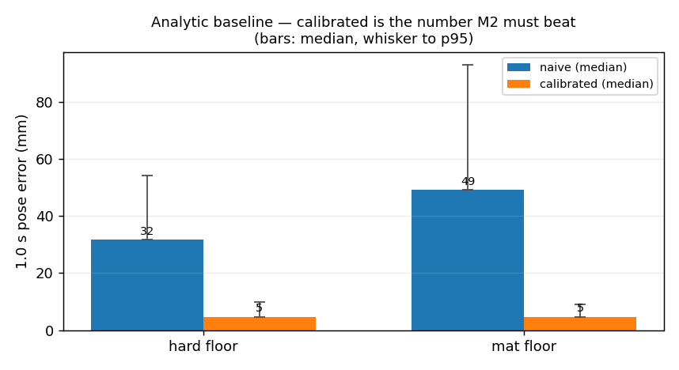
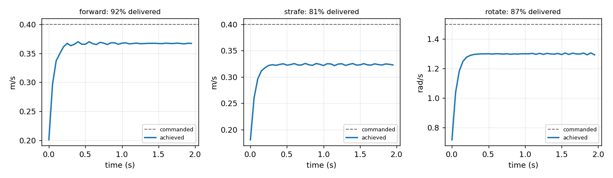
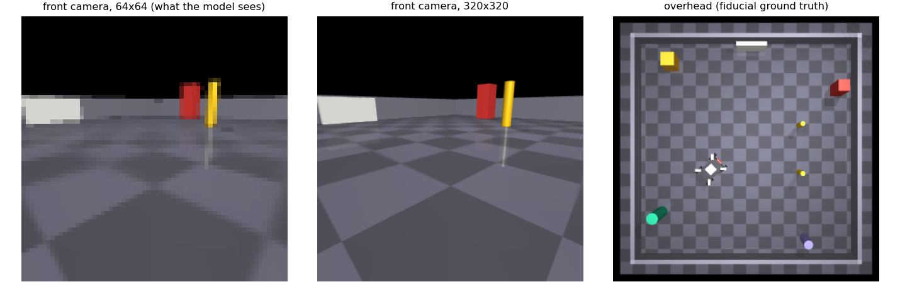

# P0 — Sim baseline

**Date:** 2026-10-10 · **Status:** complete, **corrected 2026-10-13** · **Milestone:** Phase 0

> **CORRECTION (2026-10-13).** The calibrated-analytic figure originally published here was
> **13.4 mm**. It was wrong: the lag filter was cold-started, asserting the robot was at rest at
> the beginning of every window. The corrected figure is **4.7 mm**. Found by the regression suite
> in `software/tests/`, which was built from this project's own bug history and caught it on its
> first run. Details in § Correction below.

## Question

Does the Phase 0 simulator produce a plant whose analytic model is wrong in a *structured,
learnable* way — and what is the error figure M2 has to beat?

Expected before running: strafe should lose most to slip, `mat` should be worse than `hard`, and a
four-parameter calibration should cut the naive analytic error substantially without closing it.

## Setup

- MuJoCo 3.14.0, Python 3.13.1, `mecanum_base.xml`, 20 Hz control over 500 Hz physics.
- Geometry `r=40 mm, l=90 mm, w=75 mm`; chassis 2.78 kg; wheel limit 14 rad/s.
- 8 episodes per surface, temporally correlated random actions, 1.0 s (20-tick) prediction windows.
- Split 60/40 by position in the stream, not randomly — adjacent windows share state.
- Windows that touch a wall are discarded: a tick where the command has no effect is a contact
  event, not a dynamics sample.
- Reproduce: `python software/sim/mecanum_env.py`

## Result

| | hard floor | mat |
|---|---:|---:|
| Actuator time constant | 59.3 ms translate / 60.2 ms rotate | — |
| Delivered fraction — forward / strafe / rotate | 91.8% / 80.9% / 86.7% | — |
| Naive analytic, 1.0 s median error | 31.7 mm (p95 54.1) | 49.1 mm (p95 92.8) |
| **Calibrated analytic, 1.0 s median error** | **4.7 mm** (p95 10.0) | **4.7 mm** (p95 9.1) |
| Fitted gains fwd / strafe / rot, τ | 0.93 / 0.83 / 0.79, 80 ms | 0.88 / 0.68 / 0.70, 80 ms |

Throughput 9,657 ticks/s (483× real time); 942 renders/s at 64 × 64.

Expectations held: strafe is the worst mode on both surfaces, `mat` is worse than `hard`
everywhere. Calibration cuts naive error by ~6.7×, which is a far better baseline than this
experiment originally credited it with.

## Correction: the cold-started lag filter

`first_order_lag` initialised its state at zero velocity, so the calibrated predictor began every
1.0 s window as if the robot were stationary. It almost never is. The learned models in M2 were
later given the measured start velocity as an input, so for a period the two documents reported the
same predictor at 13.4 mm and 5.27 mm and I compared them across write-ups as though they matched.

Two details worth keeping:

- **The fix is not one line at evaluation time.** Passing `v0` into a calibration that was *fitted*
  without it makes the error worse, because the inflated τ then double-counts the initial
  condition. The calibration has to be refitted.
- **τ was the tell, and I missed it.** This experiment originally fitted τ = 110–130 ms against a
  directly measured actuator τ of ~60 ms, and I wrote that off as "a single first-order lag
  compensating for speed-dependent slip". It was not. τ was absorbing the missing initial
  condition, and after the fix it lands at 80 ms. **A fitted parameter that disagrees with a
  directly measured one is a bug report, not a modelling subtlety.**

M2's internal comparison was always fair — it fitted and evaluated consistently — so M2's
conclusions are unaffected. What was wrong is this document's headline and the cross-document
narrative built on it.

## Why the calibrated model still fails

The residual it cannot absorb is where M2 should win:

1. **One τ for everything.** A single first-order lag compensates for lag *and* speed-dependent
   slip at once, so the model is misspecified even after the correction.
2. **Efficiency is not constant.** `slip_model.py` makes it fall with speed (`eta_speed`), but the
   baseline fits one scalar per mode. A learned model conditioned on velocity can represent this.
3. **Roller ripple is invisible to it.** Periodic in wheel angle, therefore predictable from
   integrated encoder counts — and completely outside a four-parameter model's hypothesis space.
4. **Battery sag is unmodelled.** `batt_v` is in the dataset as an input for exactly this reason.

## Failure analysis — three bugs this run caught

Worth recording, because all three would have silently corrupted M1 and M2:

**Step response measured against a wall.** The first run started the robot at the origin and drove
forward for 3 s — far enough to hit the arena wall before the steady-state window. It reported
forward motion as 7.8% delivered and strafe as 76.8%, i.e. exactly inverted. Fixed by starting
each probe 0.8 m from its wall and truncating on `out_of_bounds`.

**Individual wheel clipping broke the mecanum symmetry.** The action box `(0.5, 0.5, 2.0)` requires
33 rad/s from a 14 rad/s wheel, so 72% of ticks saturated. Clipping each wheel independently
destroys the mirrored roller pattern, so the discarded motion lands in the null-space scrub
direction: mean `|scrub|` read 1.004 rad/s against a proper 0.07. Fixed by scaling all four wheels
by one factor (`clamp_achievable`), which preserves direction, and by clamping sampled actions into
the achievable polytope — saturation is now 0%.

**The baseline was a strawman.** The first version compared only against uncalibrated FK, and
against a "constant velocity" predictor that was really measuring how fast actions changed. Fitting
per-mode gains plus a lag constant drops the error by 2.4×, so a learned model beating only the
naive number would have proved nothing.

## Caveat for M1 and M2

Mat shows *lower* absolute error than hard (11.8 vs 13.4 mm). That is not mat being easier — the
robot travels less far per second when it slips more, and absolute millimetres are confounded with
path length. **Normalise error by distance travelled** before comparing across surfaces, or the M6
domain-shift result will read backwards.

## Next

M2: `(state, actions) → future states`, predicting the residual on top of the calibrated model.
Target: beat **4.7 mm** median at a 1.0 s horizon on held-out `hard` episodes, then check whether
it transfers to `mat` without retraining.

(M2 was run against its own correctly-fitted baseline of 5.27 mm and beat it by 73%, so that result
stands. The two baseline figures differ only through window sampling and split.)
